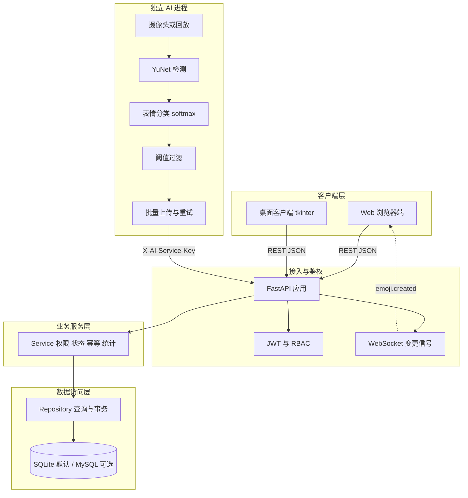
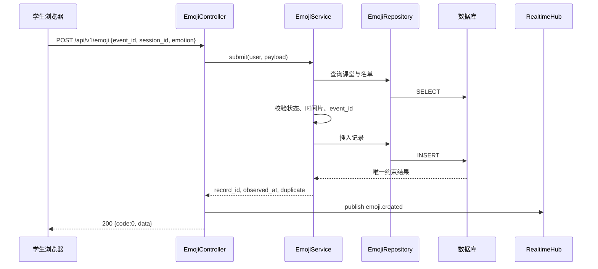
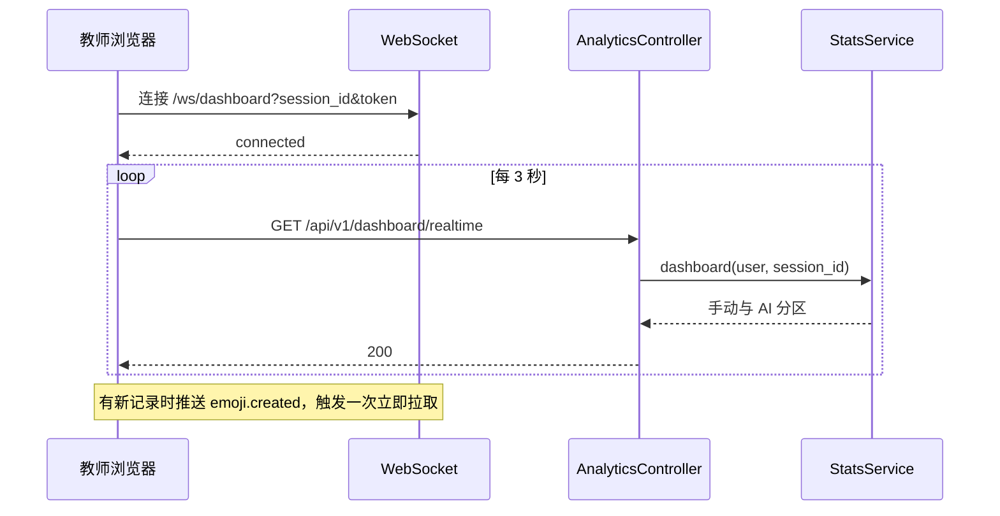
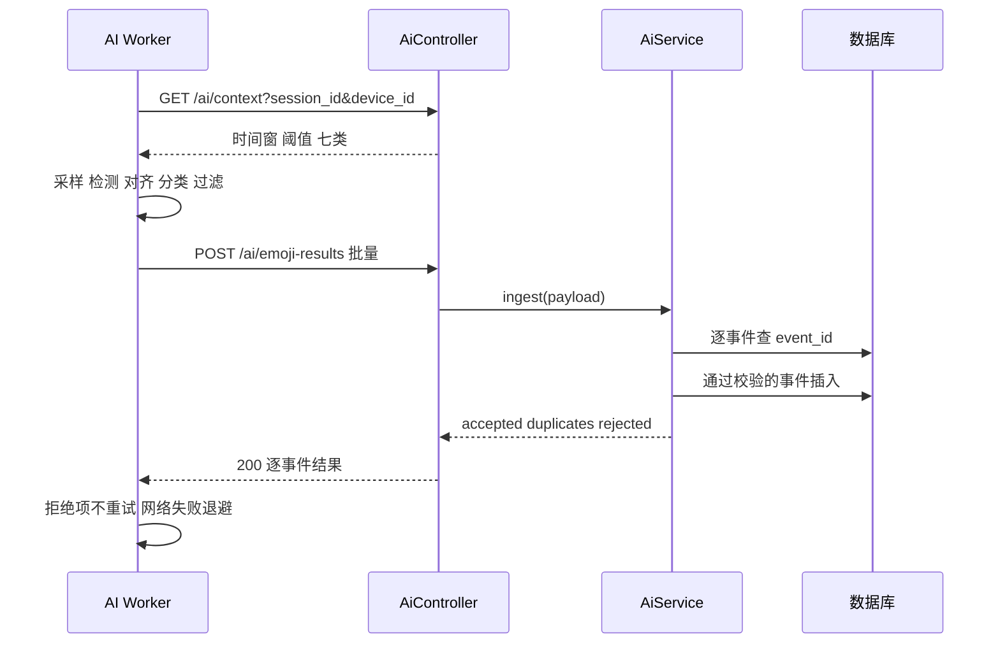
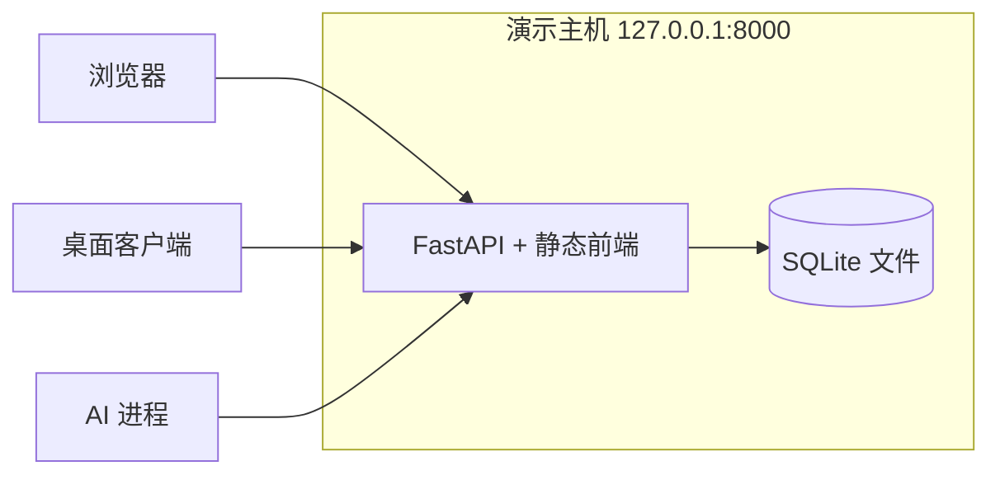

# 概要设计说明书

项目：表情符号课堂情绪检查器系统
版本：2.0
编制日期：2026 年 10 月 29 日

## 1 设计目标

1. 用清晰的分层与边界支撑四人并行开发，并让评审能从目录直接看出客户端、Web 前端、后端、AI 与数据库的职责。
2. 保证手动反馈与 AI 观察两条数据链路在权限、幂等、统计口径上互不污染。
3. 在普通电脑上可运行、可演示、可复现，不依赖公网服务。
4. 对未完成验证的形态如实标注，不以文档承诺代替实现。

## 2 总体架构

Web 与桌面客户端只通过 REST 访问后端；AI 进程使用独立服务密钥，只上报匿名分类结果，不直连数据库；数据库只允许后端访问。

## 3 修改版 MVC 说明

指导书要求“稍微修改过的 MVC”。本项目的修改点有三条：

1. 不使用服务端模板渲染，视图在浏览器内由 Vue 完成渲染。
2. 控制器职责前移到两处：前端页面控制器负责筛选、提交、导出与路由交互；后端 Controller 负责请求解析与参数绑定。
3. 三端通过统一 REST 契约通信，前端不直接访问数据库，AI 不承载业务操作。

### 3.1 前端的 Model、View、Controller

| 角色 | 实现位置 | 职责 |
| --- | --- | --- |
| Model | `frontend/src/stores/`、`frontend/src/api/` | 登录态、领域字典、网络访问与数据模型 |
| View | `frontend/src/views/`、`components/` | 页面模板、图表配置、交互绑定 |
| Controller | `frontend/src/controllers/` | 管理端筛选、课程课堂名单的读取与提交、导出 |
| ViewModel | `frontend/src/composables/` | 学生反馈提交、教师看板轮询与 WebSocket |
| Router Guard | `frontend/src/router/index.js` | 按登录态与角色放行 |

具体文件对应：

| 页面 | 控制器或组合式函数 | 说明 |
| --- | --- | --- |
| 多维统计 | `controllers/statisticsController.js` | 筛选条件、查询、CSV 导出；教师访问同一页面时隐藏导出 |
| 记录明细 | `controllers/recordsController.js` | 管理员查看全部记录、筛选与分页 |
| 课程与课堂 | `controllers/sessionController.js` | 建课、建课堂、名单、取消、表单状态 |
| 学生反馈 | `composables/useFeedback.js` | 加载课堂、生成事件 ID、提交、重置 |
| 教师看板 | `composables/useDashboard.js` | 课程课堂选择、轮询、WebSocket、学生明细 |

学生端按 MVVM 组织：View 是模板，ViewModel 是组合式函数，Repository 是 `api` 模块。管理端按客户端 MVC 组织：页面是 View，页面控制器是 Controller，状态与数据模块是 Model。

### 3.2 后端的 Controller、Service、Repository

| 层 | 目录 | 允许做的事 | 禁止做的事 |
| --- | --- | --- | --- |
| Controller | `backend/app/controllers/` | 解析请求、绑定参数、调用 Service、组装统一响应 | 写业务判断、直接拼 SQL |
| Service | `backend/app/services/` | 权限、状态、幂等、时间窗、统计口径、事务 | 依赖 FastAPI 的 Request/Response |
| Repository | `backend/app/repositories/` | 构造查询、返回实体、复用筛选条件 | 判断角色、抛业务异常 |
| Model | `backend/app/models/` | 字段、约束、索引、关系 | 业务计算、跨表查询 |
| Schema | `backend/app/schemas/` | 类型与格式校验 | 查库 |

硬约束：

1. 角色与数据归属判断只在 Service 层完成，前端菜单隐藏不构成权限。
2. 时间在库内以 UTC 保存，接口输出带时区。
3. 列表、统计、导出复用 `EmojiRepository` 的同一套 `EmojiFilters`，不各写查询。

### 3.3 桌面客户端

`desktop-client/client.py` 按 MVVM 的简化形式组织：`ApiClient` 是 Repository，`LoginFrame` 与 `MainFrame` 是 View，`DesktopApp` 负责装配与后台线程结果队列。桌面端不复制业务规则，所有校验仍由后端执行。

## 4 模块设计

### 4.1 后端模块

| 模块 | 主要类 | 职责 |
| --- | --- | --- |
| 认证 | `AuthService` | 注册、登录、改密、邀请码校验、审计 |
| 用户管理 | `UserAdminService` | 分页查询、创建教师学生、启停、最后管理员保护 |
| 课程课堂 | `CatalogService` | 课程、课堂、名单、状态与冻结规则、班级名归一 |
| 手动反馈 | `EmojiService` | 名单、状态、时间片、幂等、历史查询、学生明细 |
| 统计看板 | `StatsService` | 分区汇总、覆盖率、分布、分钟趋势 |
| 导出 | `ExportService` | 同口径筛选、CSV 转义、BOM、审计 |
| AI 入库 | `AiService` | 设备与课堂校验、阈值、时钟偏差、逐事件幂等 |
| 实时 | `RealtimeHub` | WebSocket 订阅与变更广播 |

### 4.2 前端模块

| 模块 | 文件 | 职责 |
| --- | --- | --- |
| 路由 | `router/index.js` | 公开页、角色页、登录跳转、角色守卫 |
| 网络 | `api/http.js` | 注入令牌、统一解析 `{code,message,data}`、401 清理会话 |
| 状态 | `stores/auth.js`、`stores/dict.js` | 登录态持久化、七类表情与状态字典 |
| 通用组件 | `ChartBox.vue`、`EmotionPicker.vue` | ECharts 容器、表情选择 |
| 布局 | `AppLayout.vue` | 侧边导航、角色菜单、退出 |

### 4.3 AI 进程模块

| 模块 | 文件 | 职责 |
| --- | --- | --- |
| 配置 | `ai_worker/config.py` | YAML 与环境变量、路径解析、参数校验 |
| 采集 | `ai_worker/capture.py` | 摄像头与回放、中文路径兼容、资源释放 |
| 检测 | `ai_worker/detect.py` | YuNet 动态输入、人脸框与五点 |
| 分类 | `ai_worker/classify.py` | 五点对齐、RGB 归一化、7 维 logits、softmax |
| 过滤 | `ai_worker/filter.py` | 阈值、尺寸、每帧上限、事件构造 |
| 上传 | `ai_worker/uploader.py` | 队列、批量、退避、过期、逐事件结果 |
| 主循环 | `ai_worker/runner.py` | 采样节奏、状态刷新、预览、统计 |
| 入口 | `ai_worker/cli.py` | 参数、日志、等待课堂开始、退出码 |

## 5 关键流程

### 5.1 学生提交反馈

并发下若 `event_id` 或时间片唯一约束冲突，Service 回滚后重查：内容一致返回原记录并标记 `duplicate`，内容不一致或时间片被占用返回 409。

### 5.2 教师看板刷新

WebSocket 只传信号，不传统计数据；轮询是断线恢复与兜底，两者不会产生两套口径。

### 5.3 AI 上报与入库

服务端按课堂阈值二次校验，不能依赖客户端过滤；整批字段非法返回 422 且零写入。

## 6 权限与安全设计

| 风险 | 控制 |
| --- | --- |
| 越权访问 | 每个查询追加教师归属或学生本人条件；越权返回 404，不泄露对象存在性 |
| 身份伪造 | 学生 ID 与来源由服务端赋值；客户端传入的 `user_id`、`source` 被忽略 |
| 令牌盗用 | JWT 60 分钟；`auth_version` 递增使改密、停用后的旧令牌立即失效 |
| 弱密码 | 长度 8 至 64，至少字母与数字；Argon2id 加盐哈希 |
| 邀请码泄露 | 教师与管理员使用独立邀请码，默认不配置；恒定时间比较；注册写审计 |
| AI 密钥混用 | AI 接口只接受 `X-AI-Service-Key`，用户令牌无效；密钥绑定设备与可选课堂白名单 |
| CSV 注入 | 前导空白与 `= + - @ \t \r` 前置单引号；UTF-8 BOM |
| SQL 注入 | SQLAlchemy 参数绑定，不拼接 SQL |
| 暴力登录 | 单进程滑动窗口限流；多进程限制写入部署说明 |
| 隐私 | 不保存原始帧、视频、特征向量；日志不含人脸与密钥 |

## 7 一致性与异常设计

- 统一响应：成功 `{code:0, message, data, request_id}`；失败 `{code, message, data:null, errors, request_id}`。
- 异常处理：`AppError`、`RequestValidationError`、`StarletteHTTPException`、`Exception` 四个处理器，422 不再泄露 FastAPI 默认结构。
- 幂等：手动与 AI 事件均以 `event_id` 唯一约束兜底；重试不产生重复记录。
- 事务：名单整体替换在单事务内完成；AI 批量逐事件使用保存点，单条冲突不影响整批。
- 时间：课堂状态左闭右开；AI 观测时间允许过去 60 秒、未来 5 秒；导出按东八区显示。
- 统计：手动次数、参与人数、覆盖率、AI 观察次数分别计算；分母为 0 时不计算占比。

## 8 部署视图

单机部署即可完成全部演示。可选形态包括 Docker Compose、Nginx 反向代理与 MySQL 8，配置已提供，未完成实机回归，详见 `docs/07-部署说明.md`。

## 9 设计取舍

| 决策 | 备选 | 选择理由 |
| --- | --- | --- |
| SQLite 默认 | MySQL 唯一 | 免安装、可复现；MySQL 安装与端口是验收故障点；DDL 仍提供 |
| 3 秒轮询 + WebSocket 信号 | 纯 WebSocket 推送数据 | 推送只作触发，避免两套统计口径；轮询保证断线恢复 |
| 桌面客户端用 tkinter | Electron 或 Qt | 无第三方 GUI 依赖，验收机可直接运行 |
| 班级为自由文本 | 独立班级实体 | 首版范围可控；用 NFKC 与空白归一降低统计分裂 |
| AI 只上报匿名结果 | 关联学生身份 | 避免人脸识别与隐私风险；统计口径明确为观察次数 |
| 手动与 AI 分区统计 | 合并为单一得分 | 两者分母不同，合并会产生误导 |

## 10 与详细设计的分工

本文档描述总体结构、模块边界与关键流程。字段级设计见 `docs/04-数据库设计说明书.md`，接口级设计见 `docs/05-接口文档.md`，测试设计见 `docs/06-测试报告.md`。
