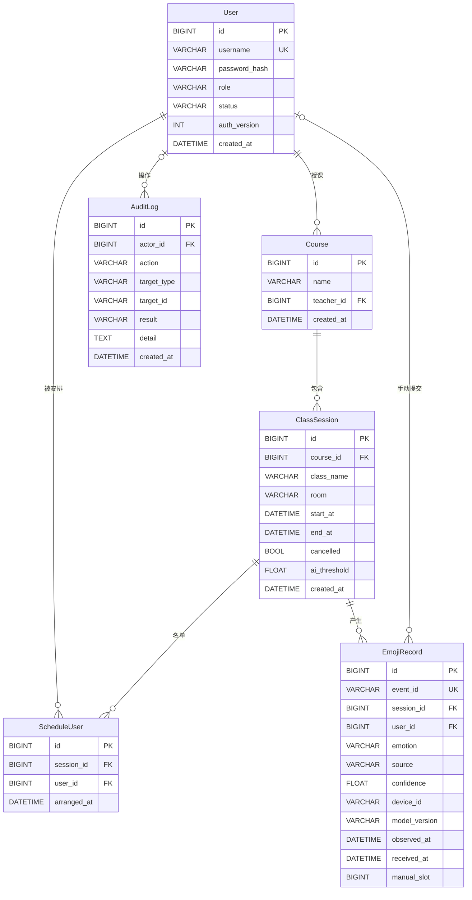

# 数据库设计说明书

项目：表情符号课堂情绪检查器系统
版本：2.0
编制日期：2026 年 10 月 29 日

## 1 设计原则

1. 所有主键使用 BIGINT 自增；SQLite 上退化为 INTEGER 以满足 rowid 自增语义。
2. 事件 ID 使用 32 位十六进制字符串，全局唯一，作为幂等键。
3. 时间统一以 UTC 存储，接口输出带时区，页面按 Asia/Shanghai 展示。
4. 枚举使用字符串加 CHECK 约束，不使用数据库原生 ENUM，便于 SQLite 与 MySQL 互转。
5. 用户停用不物理删除；课程与课堂不提供物理删除接口，保留历史关联。
6. 原始人脸帧、视频与特征向量不进入数据库。

## 2 实体关系图



AI 记录没有对应学生；`ScheduleUser` 通过多对多关系记录每节课的安排学生。审计日志的操作者在初始化任务等情况下允许为空。

## 3 表结构

### 3.1 users

| 字段 | 类型 | 空 | 默认 | 说明 |
| --- | --- | --- | --- | --- |
| id | BIGINT | 否 | 自增 | 主键 |
| username | VARCHAR(32) | 否 | — | 唯一，字母开头，3 至 32 位 |
| password_hash | VARCHAR(255) | 否 | — | Argon2id 哈希 |
| role | VARCHAR(32) | 否 | — | STUDENT / TEACHER / ADMIN |
| email | VARCHAR(120) | 是 | NULL | 仅记录，不用于找回密码 |
| status | VARCHAR(32) | 否 | ACTIVE | ACTIVE / DISABLED |
| auth_version | INT | 否 | 1 | 令牌版本，改密或启停时递增 |
| created_at | DATETIME | 否 | 当前时间 | UTC |

约束与索引：`UNIQUE(username)`；`CHECK(role IN (...))`；`CHECK(status IN (...))`；`INDEX(role)`；`INDEX(status)`。

### 3.2 courses

| 字段 | 类型 | 空 | 说明 |
| --- | --- | --- | --- |
| id | BIGINT | 否 | 主键 |
| name | VARCHAR(80) | 否 | 课程名 |
| teacher_id | BIGINT | 否 | 外键 users.id，ON DELETE RESTRICT |
| created_at | DATETIME | 否 | UTC |

约束与索引：`UNIQUE(name, teacher_id)`；`INDEX(teacher_id)`。教师角色由 Service 校验，数据库只保证引用完整性。

### 3.3 class_sessions

| 字段 | 类型 | 空 | 默认 | 说明 |
| --- | --- | --- | --- | --- |
| id | BIGINT | 否 | 自增 | 主键 |
| course_id | BIGINT | 否 | — | 外键 courses.id，ON DELETE CASCADE |
| class_name | VARCHAR(60) | 否 | — | 班级，写入前做 NFKC 与空白归一 |
| room | VARCHAR(60) | 是 | NULL | 教室 |
| start_at | DATETIME | 否 | — | 开始时间，UTC |
| end_at | DATETIME | 否 | — | 结束时间，UTC |
| cancelled | BOOL | 否 | false | 取消标记，优先于时间状态 |
| ai_threshold | FLOAT | 否 | 0.6 | 0 至 1 |
| created_at | DATETIME | 否 | 当前时间 | UTC |

约束与索引：`INDEX(course_id, start_at)`；`INDEX(start_at, end_at)`。状态不落库，由服务器时间与 `cancelled` 推导，区间为 `[start_at, end_at)`。

### 3.4 schedule_users

| 字段 | 类型 | 空 | 说明 |
| --- | --- | --- | --- |
| id | BIGINT | 否 | 主键 |
| session_id | BIGINT | 否 | 外键 class_sessions.id，ON DELETE CASCADE |
| user_id | BIGINT | 否 | 外键 users.id，ON DELETE CASCADE |
| arranged_at | DATETIME | 否 | 安排时间，UTC |

约束：`UNIQUE(session_id, user_id)`。名单整体替换时先删除再插入，事务内完成。

### 3.5 emoji_records

| 字段 | 类型 | 空 | 说明 |
| --- | --- | --- | --- |
| id | BIGINT | 否 | 主键 |
| event_id | VARCHAR(36) | 否 | 唯一，幂等键 |
| session_id | BIGINT | 否 | 外键 class_sessions.id，ON DELETE CASCADE |
| user_id | BIGINT | 是 | 手动记录为学生，AI 记录为空，ON DELETE SET NULL |
| emotion | VARCHAR(32) | 否 | 七类枚举 |
| source | VARCHAR(32) | 否 | MANUAL / AI |
| confidence | FLOAT | 是 | AI 必填，0 至 1；手动为空 |
| device_id | VARCHAR(60) | 是 | AI 设备；手动为空 |
| model_version | VARCHAR(60) | 是 | AI 模型版本；手动为空 |
| observed_at | DATETIME | 否 | 观测时间，UTC |
| received_at | DATETIME | 否 | 服务端接收时间，UTC |
| manual_slot | BIGINT | 是 | 手动时间片序号；AI 为空 |

约束：

- `UNIQUE(event_id)`。
- `UNIQUE(user_id, session_id, manual_slot)`：同一学生同一课堂同一时间片只允许一条手动记录。SQLite 与 MySQL 的唯一索引都允许多个 NULL，因此不影响匿名 AI 记录。
- `CHECK(confidence IS NULL OR (confidence >= 0 AND confidence <= 1))`。
- `CHECK(source != 'MANUAL' OR (user_id IS NOT NULL AND confidence IS NULL AND device_id IS NULL))`。
- `CHECK(source != 'AI' OR (user_id IS NULL AND manual_slot IS NULL AND confidence IS NOT NULL AND device_id IS NOT NULL))`。
- `CHECK(emotion IN ('HAPPY','NEUTRAL','SAD','ANGRY','SURPRISED','FEARFUL','DISGUST'))`。
- `CHECK(source IN ('MANUAL','AI'))`。

索引：`(session_id, observed_at)`、`(user_id, observed_at)`、`(source, observed_at)`。

### 3.6 audit_logs

| 字段 | 类型 | 空 | 说明 |
| --- | --- | --- | --- |
| id | BIGINT | 否 | 主键 |
| actor_id | BIGINT | 是 | 外键 users.id，ON DELETE SET NULL |
| action | VARCHAR(60) | 否 | 操作代码，如 ADMIN_EXPORT_EMOJI |
| target_type | VARCHAR(40) | 是 | 对象类型 |
| target_id | VARCHAR(60) | 是 | 对象 ID |
| result | VARCHAR(20) | 否 | SUCCESS / FAILURE |
| detail | TEXT | 是 | 摘要，不含密码与密钥 |
| created_at | DATETIME | 否 | UTC |

索引：`(action)`、`(created_at)`；`CHECK(result IN ('SUCCESS','FAILURE'))`。

## 4 枚举与状态

| 枚举 | 取值 |
| --- | --- |
| Role | STUDENT、TEACHER、ADMIN |
| UserStatus | ACTIVE、DISABLED |
| Source | MANUAL、AI |
| Emotion | HAPPY、NEUTRAL、SAD、ANGRY、SURPRISED、FEARFUL、DISGUST |
| SessionStatus | PENDING、ONGOING、ENDED、CANCELLED（运行时推导，不落库） |

## 5 统计口径与查询

### 5.1 指标定义

| 指标 | 计算 | 说明 |
| --- | --- | --- |
| 手动反馈次数 | `COUNT(*) WHERE source='MANUAL'` | 同一学生可多次提交 |
| 参与学生数 | `COUNT(DISTINCT user_id) WHERE source='MANUAL'` | 不等于到课人数；来源筛选为 AI 时返回 0，因为该指标只统计手动记录 |
| 覆盖率 | 参与学生数 / 课堂名单人数 | 仅单节课堂；名单为 0 时返回空 |
| 手动类别占比 | 类别手动手动数 / 手动总数 | 分母是次数 |
| AI 有效观察次数 | `COUNT(*) WHERE source='AI'` | 同一人跨帧重复计数 |
| AI 类别占比 | 类别 AI 数 / AI 总数 | 不表示独立学生比例 |
| 分钟趋势 | 按 `observed_at` 分钟桶聚合 | 空桶补 0；总量为 0 时不计算占比 |

### 5.2 代表性查询

手动与 AI 分区（简化）：

```sql
SELECT source, COUNT(*) AS total
FROM emoji_records
WHERE session_id = :session_id
GROUP BY source;
```

参与学生去重：

```sql
SELECT COUNT(DISTINCT user_id)
FROM emoji_records
WHERE session_id = :session_id AND source = 'MANUAL';
```

类别分布：

```sql
SELECT emotion, COUNT(*) AS total
FROM emoji_records
WHERE session_id = :session_id AND source = :source
GROUP BY emotion;
```

分钟趋势在应用层按 `observed_at` 的本地时间分桶，步长根据跨度在 1、5、15、30、60 分钟中选择，避免生成无意义的超长序列。SQLite 与 MySQL 的时间函数差异因此不影响口径。

### 5.3 筛选条件复用

列表、统计、导出统一使用 `EmojiFilters`，包含课程、课堂、班级、起止时间、来源、用户、教师归属与情绪。教师归属条件由 Service 强制追加，调用方传入的 `user_id` 不能扩大范围。

## 6 索引与性能

| 索引 | 服务的查询 |
| --- | --- |
| `(session_id, observed_at)` | 课堂看板、课堂历史、趋势 |
| `(user_id, observed_at)` | 学生个人历史 |
| `(source, observed_at)` | 按来源筛选与统计 |
| `(course_id, start_at)` | 课程下课堂列表 |
| `(start_at, end_at)` | 状态与时间范围筛选 |
| `UNIQUE(session_id, user_id)` | 名单校验与去重 |

首版数据规模约 100 个账号、1 万条记录，以上索引足够。性能目标未在固定数据集上压测，结题报告不写成已达标。

## 7 初始化与迁移

### 7.1 SQLite

`AUTO_CREATE_TABLES=true` 时应用启动调用 `create_all` 建表。演示数据使用：

```powershell
cd backend
..\.venv\Scripts\python.exe scripts\seed_demo.py --reset     # 删除全部表后重建
..\.venv\Scripts\python.exe scripts\seed_demo.py --refresh   # 只平移演示课堂时间
```

`--refresh` 用于录制前刷新“未开始、进行中、已结束”三种课堂状态，保留用户与历史记录。

### 7.2 MySQL 8

`db/schema_mysql.sql` 由 SQLAlchemy 模型生成，包含 6 张表、10 个索引与全部 CHECK 约束，字符集 utf8mb4，引擎 InnoDB。执行方式见 `db/README.md`。

**未完成项**：未在 MySQL 实例上执行全量回归；文档与报告按“脚本已提供、未实测”表述。

### 7.3 变更管理

当前版本不引入 Alembic。表结构变更时同时修改模型、`db/schema_mysql.sql` 与文档，并在开发库执行 `seed_demo.py --reset` 重建。生产形态若启用，应补充迁移脚本与回滚方案。

## 8 数据安全与隐私

- `password_hash` 只存 Argon2id 哈希，接口与导出均不返回。
- AI 记录不包含姓名、学号、人脸图像或特征向量。
- 审计日志不记录密码、密钥、原始帧。
- 导出包含学生账号与表情记录，仅管理员可执行，并写入审计日志。
- 数据库文件与 `.env` 不提交仓库，`.gitignore` 已覆盖 `data/`、`*.db`、`.env`。
