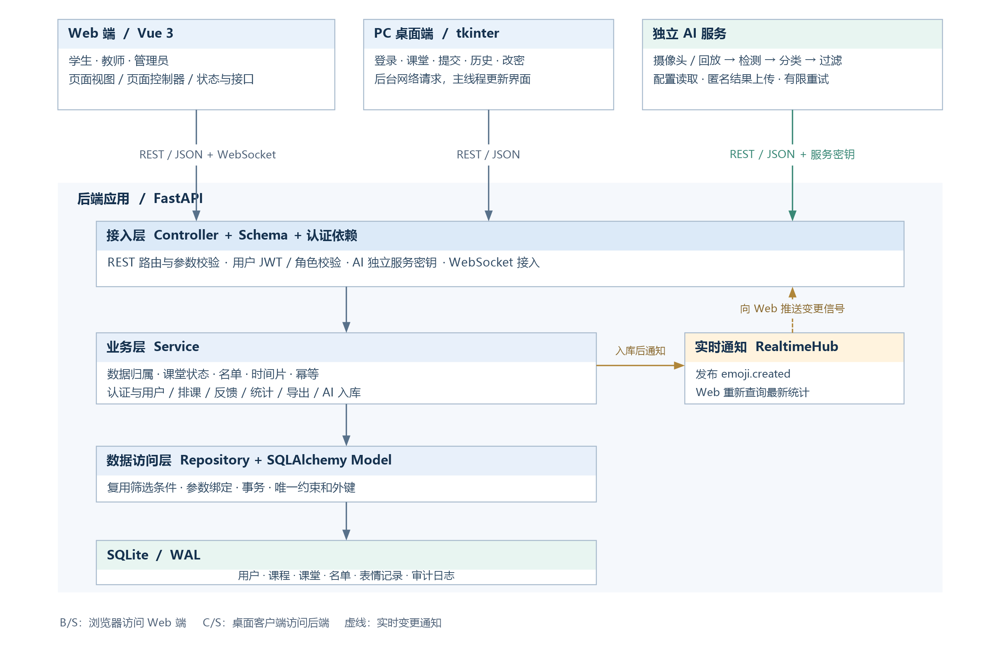
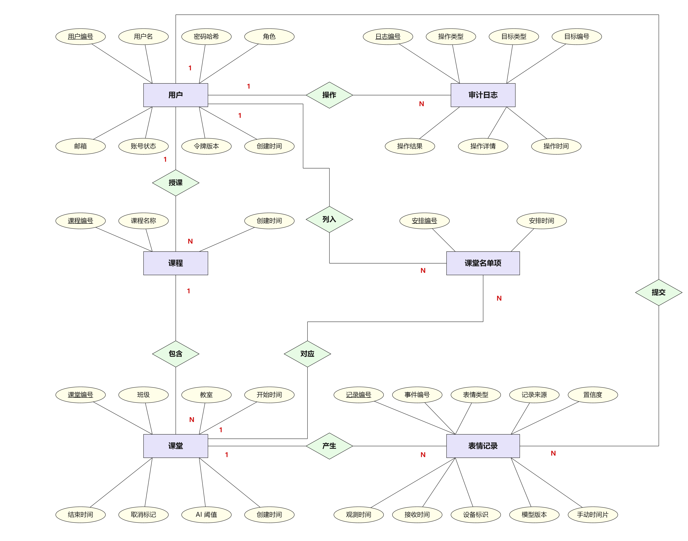

# 表情符号课堂情绪检查器系统实验报告

**软件工程实践课程实验报告**

**组长姓名：** 韩雨桐　　**学号：** PB23111693
**组员姓名：** 姜文龙　　**学号：** PB23111727
**组员姓名：** 李炯和　　**学号：** PB23111728
**组员姓名：** 曾海湾　　**学号：** PB23111696

**代码仓库：** https://github.com/PB23111693/EmojiChecker

## 摘要

本文面向课堂反馈场景，设计并实现了一套由 Web 端、桌面客户端、后端服务和独立 AI 推理进程组成的表情符号课堂情绪检查器。系统支持学生在已安排的课堂中主动提交七类表情，教师查看所授课堂的实时看板、参与学生明细和多维统计，管理员管理用户、课程、课堂与名单，查询全部记录并导出 CSV；独立 AI 进程从摄像头或回放视频中取帧，使用 YuNet 检测人脸、MobileFaceNet 分类表情，按课堂阈值过滤后匿名上报，后端完成二次校验与入库。系统采用 B/S 与 C/S 混合结构。Web 端使用 Vue 3，桌面端使用 Python tkinter，后端使用 FastAPI 的 Controller、Service、Repository 分层，默认数据库为 SQLite。

**关键词：** 课堂反馈；角色访问控制；事件幂等；实时看板；表情分类；匿名数据

## 1 引言

### 1.1 研究背景

课堂中的学生反馈通常通过提问、举手或课后问卷收集。这些方式存在两个问题：一是反馈时间滞后，教师难以在授课过程中调整节奏；二是匿名表达渠道有限，部分学生不愿公开表达困惑或负面感受。表情符号提供了一种低成本的即时表达方式，但单次表情只代表学生的主动选择，不能等同于学生的真实心理状态。

摄像头为课堂观察提供了另一种数据来源。人脸检测和表情分类可以给出某一时刻、某一区域的可见表情分布，但这类结果受光照、姿态、遮挡、个体差异和模型训练分布影响。若把模型输出直接解释为“学生开心”或“教学有效”，会把统计观察误当成心理测量。基于这一边界，本系统将学生主动提交与 AI 观察分成两条数据链路：前者关联学生，后者只记录匿名分类结果；两者在统计中分别计算，不合并为单一的课堂情绪得分。

系统需要解决的核心工程问题包括：

1. 三类角色和独立 AI 进程如何共享一套接口，同时保持数据范围隔离；
2. 课堂时间、名单和提交资格如何在服务端约束，避免客户端绕过；
3. 重复提交、网络重试和并发写入如何保证幂等；
4. 手动记录与 AI 观察如何在同一看板中呈现而不混淆分母；
5. 摄像头推理、阈值过滤和上传重试如何独立运行，并与后端状态保持一致。

### 1.2 技术背景与相关工作

后端采用 FastAPI。FastAPI 基于 Python 类型注解生成请求校验和 OpenAPI 文档；数据访问使用 SQLAlchemy 2.0，模型、查询和事务集中管理；默认数据库为 SQLite，开启 WAL，以减少演示环境的安装依赖。

Web 端使用 Vue 3、Vite、Element Plus 和 ECharts。Vue 的单文件组件适合按角色拆分页面，Vite 提供生产构建，Element Plus 提供表格、表单和对话框，ECharts 用于类别分布与分钟趋势。桌面客户端使用 Python 标准库 tkinter 与 urllib，不引入第三方 GUI 依赖，作为 C/S 通道的实现。

AI 部分使用 OpenCV Zoo 的 YuNet 人脸检测模型和 MobileFaceNet 表情分类模型。YuNet 是轻量人脸检测器，2026may 版本支持动态输入尺寸；表情模型输出七类表情的 logits。OpenCV Zoo 官方 Python 封装在后处理阶段使用 argmax 返回类别，不直接提供置信度，因此本项目读取原始输出并执行 softmax，取最大类得分作为过滤依据。

## 2 实验环境与工程实现

### 2.1 软硬件环境

实验在单台 Windows 主机上完成，Web、后端、桌面客户端和 AI 进程均在本机运行，数据库为本地 SQLite 文件。主要版本如下。

| 项目 | 配置 |
| --- | --- |
| 操作系统 | Windows 11 Home China，10.0.26200 |
| Python | 3.12.2 |
| 后端 | FastAPI 0.141.1、Pydantic 2.12.5、SQLAlchemy 2.0.45 |
| 数据库 | SQLite，项目库启用 WAL |
| Web 构建 | Node.js 22.20.0、npm 10.9.3、Vite 6.4.5 |
| Web 运行库 | Vue 3、Element Plus、ECharts |
| 桌面客户端 | Python 标准库 tkinter、urllib、threading、queue |
| AI 推理 | OpenCV 5.0.0、ONNX Runtime 1.20.1、NumPy 2.3.2，CPU |
| 测试 | pytest 9.1.1、FastAPI TestClient、Node 内置测试运行器 |

AI 推理使用 CPU。模型文件与业务数据库均保存在本地，不依赖公网服务。

### 2.2 代码组织

项目按职责分为七个目录，避免前端、后端、桌面端和 AI 逻辑相互耦合。

| 目录 | 内容 |
| --- | --- |
| `backend/` | FastAPI 应用、数据库模型、服务、仓储、接口、测试和初始化脚本 |
| `frontend/` | Vue 3 页面、控制器、组合式函数、状态、接口封装和构建配置 |
| `desktop-client/` | tkinter 客户端及其轮询容错测试 |
| `ai-worker/` | 摄像头/回放采集、YuNet 检测、表情分类、过滤、上传和命令行入口 |
| `db/` | MySQL 8 建表脚本与数据库说明 |
| `deploy/` | Dockerfile、Nginx 配置 |
| `submission/` | 交付版文档与实验报告 |

后端内部按 `controllers`、`services`、`repositories`、`models`、`schemas` 分层；前端按 `views`、`controllers`、`composables`、`stores`、`api`、`router` 分层。AI 进程中的 `capture.py`、`detect.py`、`classify.py`、`filter.py`、`uploader.py`、`runner.py` 可以独立测试。
## 3 需求分析
**系统的业务范围、功能需求及非功能需求详见[需求规格说明书](需求规格说明书.md)。**
### 3.1 角色与数据范围

| 角色 | 主要任务 | 数据范围 |
| --- | --- | --- |
| 学生 | 注册、登录、改密、提交表情、查看个人历史 | 本人被安排的课堂及本人手动记录 |
| 教师 | 登录、改密、查看课堂看板、学生明细、多维统计 | 本人所授课程及其课堂 |
| 管理员 | 登录、改密、用户管理、课程课堂名单、记录查询、统计、导出、审计 | 全部业务数据 |
| AI 服务 | 获取课堂配置、采样推理、上传匿名结果 | 授权设备与指定课堂 |

学生公开注册；教师与管理员分别使用独立邀请码注册。所有角色校验和数据归属判定在服务端执行，前端菜单隐藏只用于导航。教师访问他人课堂返回 404，学生访问管理接口返回 403。

### 3.2 功能需求

| 编号 | 功能 | 关键规则 |
| --- | --- | --- |
| FR01 | 注册、登录、改密 | 学生公开注册；教师/管理员邀请码；密码 8—64 位且含字母和数字；Argon2id |
| FR02 | 用户管理 | 管理员分页查询、创建教师学生、启停；保护当前账号和最后一名启用管理员 |
| FR03 | 课程与课堂 | 课程指定教师；课堂含班级、教室、起止时间、AI 阈值；开始后冻结 |
| FR04 | 课堂名单 | 事务内整体保存、去重；仅启用学生；名单表示提交资格 |
| FR05 | 学生提交表情 | 名单内、进行中、七类表情、30 秒时间片、事件编号幂等 |
| FR06 | 学生个人历史 | 仅本人手动记录；按课堂、课程、日期筛选、分页 |
| FR07 | 教师课堂查询 | 仅所授课程；反馈次数、参与人数、学生明细 |
| FR08 | 实时看板 | 手动与 AI 分区；次数、人数、覆盖率、分布、趋势、更新时间 |
| FR09 | 多维统计 | 课程、班级、日期、来源、表情筛选；记录数、次数、人数、分布、趋势 |
| FR10 | 管理员记录明细 | 全部分页查看；条件与统计一致；AI 行显示匿名 |
| FR11 | CSV 导出 | 仅管理员；UTF-8 BOM；公式前缀转义；最多 50000 行 |
| FR12 | AI 采集与入库 | 摄像头/回放、检测、分类、阈值、匿名批量上传、幂等、时限 |
| FR13 | 桌面客户端 | 登录、选课、提交、历史、改密；共用 REST |
| FR14 | 权限与审计 | 服务端角色/归属校验、参数绑定、限流、关键操作审计 |
| FR15 | 初始化与部署 | 建表、演示数据、课堂时间刷新、README、部署说明 |

### 3.3 核心业务规则

**课堂时间。** 课堂状态不单独落库，由服务器时间与取消标记推导。设开始时间为 $s$、结束时间为 $e$、当前时间为 $t$，则：

$$
\text{PENDING} \iff t<s,\qquad
\text{ONGOING} \iff s\le t<e,\qquad
\text{ENDED} \iff t\ge e
$$

取消标记优先于时间状态。管理员只能在待开始时修改课堂时间、班级、教室、阈值和名单；开始后冻结。创建和修改课堂的时间字段必须带时区偏移，缺少偏移返回 422。

**名单。** 名单保存时在事务内删除旧名单、插入去重后的新名单。只有启用学生可以加入；非学生、停用或不存在的用户返回 422。课堂开始后保存名单返回 409。名单表示提交资格，不代表出勤，也不作为覆盖率之外的出勤依据。

**手动提交。** 请求包含 `event_id`、`session_id` 和 `emotion`。学生身份、来源和观测时间由服务端赋值。同一事件编号重试且内容一致时返回原记录并标记 `duplicate=true`；内容冲突返回 409。新事件必须由名单内学生在进行中的课堂提交。默认时间片为 30 秒，片号按服务器 Unix 秒数除以时间片长度并向下取整：

$$
\text{slot}=\left\lfloor \frac{t_{\text{unix}}}{L} \right\rfloor
$$

其中 $L$ 为 `MANUAL_SLOT_SECONDS`，设为 0 时不限制。数据库对 `(user_id, session_id, manual_slot)` 建联合唯一约束。

**统计口径。** 手动反馈次数按记录数统计；参与人数按手动记录中的学生编号去重；覆盖率仅在名单非空时计算。AI 有效观察次数按通过阈值的人脸结果统计，同一人跨帧重复计数。手动与 AI 分布分别以各自总数为分母；多维统计按当前筛选记录总数计算，来源筛选为 AI 时参与人数返回 0。


## 4 系统设计

### 4.1 总体架构
**架构图、目录职责和关键流程详见[概要设计](概要设计.md)。**

系统由 Web 端、桌面端、AI 进程和后端服务组成。Web 端承担三类角色的页面交互，桌面端承担学生业务的 C/S 通道，AI 进程独立运行。三者通过 REST 访问后端；数据库由后端统一读写。



WebSocket 在记录入库后推送变更信号。页面收到信号后重新请求看板和参与学生明细；页面可见时保留 3 秒轮询，作为断线和推送丢失的补充。推送不承载统计数据，统计口径只由 REST 查询决定。

### 4.2 修改版 MVC

Web 端不使用服务端模板渲染，页面在浏览器中渲染。管理端将筛选、查询、导出和名单操作放入 `controllers`；学生和教师端将提交、轮询和状态管理放入 `composables`；`stores` 与 `api` 负责登录态、领域字典和网络访问。

| 层次 | 实现位置 | 职责 |
| --- | --- | --- |
| View | `frontend/src/views/`、`components/` | 页面、表格、图表、表情选择器 |
| Controller | `frontend/src/controllers/` | 统计筛选、课程课堂名单、记录明细 |
| ViewModel | `frontend/src/composables/` | 学生反馈、教师看板轮询与 WebSocket |
| Model/Repository | `frontend/src/stores/`、`api/` | 登录态、领域字典、接口调用 |
| 路由守卫 | `frontend/src/router/` | 登录态与角色页面访问 |

后端 Controller 只负责请求解析、参数绑定和响应组装；Service 负责权限、课堂状态、名单、时间片、幂等、统计和事务；Repository 负责查询并复用筛选条件。业务规则不写在路由或前端。

### 4.3 数据模型
**实体关系图、表结构与约束详见[数据库设计](数据库设计.md)。**

系统包含六张核心表：用户、课程、课堂、名单项、表情记录和审计日志。




| 表 | 主要字段 | 约束与作用 |
| --- | --- | --- |
| `users` | 用户名、密码哈希、角色、状态、`auth_version` | 用户名唯一；角色与状态 CHECK |
| `courses` | 课程名、教师外键 | `(name, teacher_id)` 唯一；教师外键 RESTRICT |
| `class_sessions` | 课程、班级、教室、起止时间、取消标记、AI 阈值 | 课程外键；按课程和开始时间建索引 |
| `schedule_users` | 课堂、学生、安排时间 | `(session_id, user_id)` 唯一 |
| `emoji_records` | 事件编号、课堂、学生、表情、来源、置信度、设备、模型版本、时间 | `event_id` 唯一；`(user_id, session_id, manual_slot)` 唯一；来源形状 CHECK |
| `audit_logs` | 操作者、动作、目标、结果、详情、时间 | 结果 CHECK；操作者可为空 |

手动记录的 `user_id` 非空，AI 记录的 `user_id` 固定为空。AI 记录必须带置信度、设备和模型版本；手动记录不写这些字段。数据库使用外键、唯一约束和 CHECK 作为最后约束，Service 仍执行完整业务校验。

### 4.4 接口与错误模型
**请求字段、权限及返回值见[API 文档](API文档.md)。**

业务接口统一使用 `/api/v1`。成功响应为：

```json
{"code": 0, "message": "ok", "data": {}, "request_id": "..."}
```

失败响应包含 `code`、`message`、`data=null`、`request_id` 和可选 `errors`。HTTP 状态与业务码对应：401 未登录或凭据失效，403 无权限，404 对象不存在或不在可见范围，409 状态冲突，422 参数错误，429 请求过频。CSV 返回文件流，不套 JSON。

| 业务 | 代表接口 | 服务端控制 |
| --- | --- | --- |
| 认证 | `/auth/register`、`/auth/login`、`/auth/password` | 邀请码、密码强度、令牌版本 |
| 用户 | `/users/me`、`/admin/users`、`/admin/users/{id}/status` | 本人或管理员 |
| 课程课堂 | `/courses`、`/sessions`、`/admin/sessions` | 角色范围、时间窗、冻结 |
| 名单 | `/admin/sessions/{id}/members` | 教师/管理员可读，管理员可改 |
| 反馈 | `/emoji`、`/emoji/history` | 名单、状态、时间片、事件幂等 |
| 看板统计 | `/dashboard/realtime`、`/statistics` | 教师课程归属、手动/AI 分区 |
| 导出 | `/admin/emoji/export` | 仅管理员、同筛选条件 |
| AI | `/ai/context`、`/ai/emoji-results` | 服务密钥、设备、课堂、阈值、幂等 |

### 4.5 认证与授权

密码使用 Argon2id 加盐哈希。JWT 携带用户编号、角色和 `auth_version`；每次请求读取账户状态，并比较令牌版本。改密、启用或停用递增版本，旧令牌立即失效。

角色校验在依赖层完成，数据归属在 Service 层追加：教师查询强制 `Course.teacher_id = current_user.id`；学生查询强制 `user_id = current_user.id` 且 `source=MANUAL`；管理员可访问全局数据。教师与管理员名单接口使用 `require_staff`，学生不能读取全班名单或全站班级候选。

AI 接口使用 `X-AI-Service-Key`，与用户 JWT 分离。服务端校验设备标识、可选课堂白名单、课堂状态和观测时间；用户令牌不能调用 AI 接口。

### 4.6 AI 流程设计

AI 进程的处理链路为：

```text
摄像头/回放
→ 按间隔取帧
→ YuNet 检测人脸与五点
→ 五点对齐到 112×112
→ 表情 ONNX 推理
→ softmax 取最大类
→ 置信度、尺寸、每帧数量过滤
→ 生成匿名事件
→ 批量上传
→ 后端复核并入库
```

设模型七维输出为 $z=(z_1,\ldots,z_7)$，则：

$$
p_k=\frac{\exp(z_k)}{\sum_{j=1}^{7}\exp(z_j)},\qquad
\hat{k}=\arg\max_k p_k,\qquad
\hat{c}=p_{\hat{k}}
$$

其中 $\hat{k}$ 为类别，$\hat{c}$ 为置信度。模型输出是 logits，不是概率；代码先执行 softmax，再取最大类得分。

事件通过条件为：置信度不低于课堂阈值、人脸最小边不小于 48 像素、每帧处理不超过 5 张人脸、观测时间位于课堂区间内，并与服务器时间偏差不超过 60 秒（过去）和 5 秒（未来）。

### 4.7 时间与统计口径

数据库以 UTC 保存时间，接口输出带偏移的 ISO 8601。Web 页面、统计分桶和 CSV 统一按 Asia/Shanghai 展示；桌面客户端按运行机器的本地时区格式化。课堂区间为左闭右开，达到结束时刻即不再接收新反馈。

手动反馈次数、参与人数、覆盖率和 AI 观察次数的定义见 3.3 节。趋势按观测时间分桶，分桶粒度在 1、5、15、30、60 分钟之间按跨度选择；空桶补 0，不填充中性情绪。

## 5 系统实现

### 5.1 后端分层

| 模块 | 文件 | 职责 |
| --- | --- | --- |
| 认证 | `services/auth_service.py` | 注册邀请码、登录、改密、令牌版本 |
| 用户 | `services/user_service.py` | 查询、创建、启停、最后管理员保护 |
| 课程课堂 | `services/catalog_service.py` | 时间状态、冻结、名单去重、班级名归一 |
| 反馈 | `services/emoji_service.py` | 名单、状态、时间片、幂等、历史 |
| 统计 | `services/stats_service.py` | 手动/AI 分区、覆盖率、分布、趋势 |
| 导出 | `services/export_service.py` | 同口径筛选、CSV 转义、BOM、审计 |
| AI 入库 | `services/ai_service.py` | 设备、课堂、时间窗、阈值、逐事件幂等 |
| 实时 | `core/realtime.py` | WebSocket 订阅与广播 |

手动提交的处理顺序是：确认课堂存在和名单资格；按 `event_id` 查重，内容一致返回原记录；对新增事件检查课堂状态；计算时间片并写入；唯一约束冲突后回滚重查。这个顺序允许学生在课堂结束后确认此前已成功、但响应丢失的提交。

AI 入库先校验服务密钥、设备、课堂授权和课堂状态，再逐事件校验时间窗、时钟偏差和阈值。每条插入使用保存点，单条冲突不影响同批其他事件；最终返回 `accepted`、`duplicates`、`rejected` 和逐事件明细。

### 5.2 Web 前端

学生页面包括“我的课堂”“课堂反馈”“我的记录”；教师页面包括“课堂看板”和“多维统计”；管理员页面包括“课堂看板”“多维统计”“课程与课堂”“用户管理”“记录明细”“审计日志”。

| 页面 | 实现 | 职责 |
| --- | --- | --- |
| 多维统计 | `controllers/statisticsController.js` | 筛选、查询、导出条件复用 |
| 记录明细 | `controllers/recordsController.js` | 全部记录筛选与分页 |
| 课程与课堂 | `controllers/sessionController.js` | 建课、建课堂、名单、取消 |
| 学生反馈 | `composables/useFeedback.js` | 加载课堂、事件编号、提交、重置 |
| 教师看板 | `composables/useDashboard.js` | 课程课堂选择、轮询、WebSocket、学生明细 |

看板轮询每 3 秒执行一次，上一次请求完成后再发起下一次；WebSocket 收到 `emoji.created` 时立即刷新。切换课堂使用请求序号与课堂编号校验，过期响应不会覆盖当前课堂。

### 5.3 桌面客户端

`desktop-client/client.py` 使用 `ApiClient` 封装 HTTP 请求，使用 tkinter 构建登录页和主界面。网络请求在后台线程执行，结果放入 `queue.Queue`，主线程轮询队列并更新控件。迟到回调访问已销毁控件时被捕获，下一次轮询仍会继续安排。

### 5.4 AI 推理进程

| 模块 | 实现 |
| --- | --- |
| 配置 | YAML 与环境变量、摄像头/回放、采样间隔、阈值、模型路径 |
| 采集 | 摄像头或视频文件，回放标记 `is_replay` |
| 检测 | YuNet 2026may 动态输入，返回人脸框、五点、检测分 |
| 分类 | 五点对齐、RGB、归一化、ONNX logits、softmax |
| 过滤 | 置信度、最小人脸、每帧上限、事件构造 |
| 上传 | 队列、批量、退避、30 秒过期、逐事件结果 |
| 主循环 | 采样节奏、配置刷新、预览、统计 |
| 入口 | 参数、日志、课堂等待、退出码 |

模型文件：

- `face_detection_yunet_2026may.onnx`，用于人脸检测，支持动态输入；
- `facial_expression_recognition_mobilefacenet_2022july.onnx`，用于七类表情分类；
- 分类输入为 `1×3×112×112` 的 float32 张量；
- 分类输出为 `1×7` logits；
- 类别顺序为 `ANGRY、DISGUST、FEARFUL、HAPPY、NEUTRAL、SAD、SURPRISED`。

上传队列上限 100 条，单批最多 100 条；传输失败或 5xx 按 1、2、4、8 秒退避；单事件最长保留 30 秒；401/403 立即停止；请求级 422 整批丢弃；HTTP 200 的逐事件拒绝只丢弃对应事件。每次重试前重新检查事件年龄。

### 5.5 AI 局限性分析

1. **采集条件与样本偏差**。逆光、侧脸或遮挡会降低人脸被检出的机会，距离较远的人脸在图像中也更小。Worker 按人脸检测分数排序，默认仅对每帧排名前 5 的候选进行分类，再过滤短边小于 48 像素或表情置信度低于阈值的结果。因此，靠近镜头、光线充足且正对镜头的学生可能贡献更多观测，后排或被遮挡的学生可能较少被计入。

2. **预训练模型的泛化差异**。课堂里的人群、拍摄角度和表情幅度可能与预训练样本不同，MobileFaceNet 在这些条件下可能出现类别混淆。最高 softmax 得分用于筛选预测，高分结果也可能误判。要估计模型在实际课堂中的识别表现，需要用具有代表性的课堂画面进行人工标注，并按表情类别和拍摄条件比较预测与标注。

3. **离散采样与重复计数**。Worker 默认以 3 秒为目标周期取帧，处理或上传耗时较长时，实际间隔可能进一步拉长。一次表情如果完整发生在两次取帧之间，就可能被遗漏。同一帧通过筛选的多张人脸各生成一条事件，同一学生在连续四次采样中都通过筛选，就会贡献四次观测。`event_id` 用于识别同一事件的重传。看板按事件统计 AI 观察次数，学生参与人数则按手动反馈的学生去重计算。

## 6 实验流程与质量控制
**测试环境、用例及结果详见[测试报告](测试报告.md)。**
### 6.1 测试环境与数据

接口测试为每个用例创建独立内存 SQLite，使用 `StaticPool` 让接口线程与测试线程共享同一数据库。测试基座按场景创建管理员、教师、学生、课堂和名单；时间相关用例控制课堂起止时刻或使用固定时钟，分别检验时间窗、名单冻结和重试边界。测试不读写业务数据库。

AI 单元测试使用真实 ONNX 模型对固定随机输入和黑帧推理；上传、队列和上下文刷新使用受控替身注入网络错误、5xx、401 和课堂消失。桌面客户端测试注入失效回调和正常回调，检查轮询链不中断。前端时间测试在 UTC、Asia/Shanghai、America/New_York 三个子进程中运行。

### 6.2 测试层次与命令

| 层次 | 命令 | 覆盖范围 |
| --- | --- | --- |
| 后端全量 | `pytest backend` | 认证、用户、课程课堂、反馈、统计、导出、AI、端到端、初始化 |
| 后端单模块 | `pytest backend/tests/test_*.py` | 按模块定位失败 |
| AI | `pytest ai-worker` | 分类、过滤、上传、配置、Runner 上下文 |
| 桌面 | `pytest desktop-client` | 迟到回调后的轮询恢复 |
| 前端时间 | `npm test` | 三时区显示、编辑回写、非法时间 |
| 前端构建 | `npm run build` | 页面、组件、状态和接口模块可打包 |

### 6.3 主要结果

| 验证项目 | 结果摘要 |
| --- | --- |
| 后端业务与接口 | 52 项测试通过，覆盖认证、课堂名单、反馈、查询、统计导出及 AI 入库 |
| AI 服务 | 20 项测试通过，覆盖分类、过滤、配置、上传和异常处理 |
| 桌面回调容错 | 1 项测试通过，异常回调后结果处理和轮询继续 |
| 前端时间处理 | 4 项测试通过，三种系统时区下的北京时间显示、编辑及非法时间处理一致 |
| 前端构建 | 生产构建成功 |
| 业务联调 | 学生提交、教师查询和管理员导出链路贯通，WebSocket 可通知记录变化；AI 回放结果匿名入库，桌面核心交互可完成 |

接口级端到端场景中，管理员建立课堂并安排一名学生，学生提交一条记录后，教师看板的反馈次数与参与人数均为 1，覆盖率为 1，管理员导出 1 行记录；其他教师访问该课堂被拒绝。该结果说明课堂安排、提交、查询和导出能够保持关联与统计一致。

AI 回放样例完成一次有效采样并产生匿名记录，类别为 NEUTRAL、置信度约 0.7366，课堂、设备和模型信息随结果保存。
## 7 结论

系统完成了以课堂名单为范围的学生主动反馈，并将教师看板、管理员统计导出、记录明细和匿名 AI 观察接入同一后端。Web 端、桌面端和 AI 进程通过统一接口协作，服务端执行权限、时间窗、幂等和阈值规则。接口级流程测试验证了排课到导出的数据一致性，回放和摄像头记录验证了分类结果的匿名入库路径。

## 8 复现说明

### 8.1 环境准备

```powershell
cd "D:\软件工程实践\SE-EmojiChecker"
python -m venv .venv
.\.venv\Scripts\python.exe -m pip install -r backend\requirements.txt
.\.venv\Scripts\python.exe -m pip install -r ai-worker\requirements.txt
```

### 8.2 初始化与启动

```powershell
cd backend
..\.venv\Scripts\python.exe scripts\seed_demo.py --reset
..\.venv\Scripts\python.exe scripts\seed_demo.py --refresh
$env:PYTHONUTF8=1
..\.venv\Scripts\python.exe -m uvicorn app.main:app --host 127.0.0.1 --port 8000
```

前端首次运行：

```powershell
cd frontend
npm install
npm run build
```

### 8.3 测试命令

| 工作目录 | 命令 |
| --- | --- |
| `backend/` | `..\.venv\Scripts\python.exe -m pytest` |
| `ai-worker/` | `..\.venv\Scripts\python.exe -m pytest` |
| `ai-worker/` | `..\.venv\Scripts\python.exe scripts\download_models.py --check-only` |
| `desktop-client/` | `..\.venv\Scripts\python.exe -m pytest` |
| `frontend/` | `npm test` |
| `frontend/` | `npm run build` |

### 8.4 AI 演示

```powershell
cd ai-worker
$env:AI_SERVICE_KEY="dev-ai-service-key-change-me"
$env:AI_DEVICE_ID="demo-device-01"
$env:AI_API_BASE="http://127.0.0.1:8000"
..\.venv\Scripts\python.exe run.py --config config.example.yaml --session-id 1
```

回放时使用 `--video`，画面和日志会显示 `REPLAY INPUT`。摄像头演示时按 `q` 退出，课堂结束后进程自动停止。

**完整命令、账号以及各角色操作见[部署说明与用户手册](部署说明与用户手册.md)。**
## 附录 A　主要接口与字段

| 方法 | 路径 | 权限 |
| --- | --- | --- |
| POST | `/api/v1/auth/register` | 公开，按角色校验邀请码 |
| POST | `/api/v1/auth/login` | 公开 |
| PUT | `/api/v1/auth/password` | 登录用户 |
| GET/POST | `/api/v1/admin/users` | 管理员 |
| PATCH | `/api/v1/admin/users/{id}/status` | 管理员 |
| GET/POST | `/api/v1/admin/courses` | 管理员 |
| GET | `/api/v1/sessions` | 登录用户，按角色范围 |
| POST | `/api/v1/admin/sessions` | 管理员 |
| PATCH | `/api/v1/admin/sessions/{id}` | 管理员，未开始 |
| GET/PUT | `/api/v1/admin/sessions/{id}/members` | 教师/管理员读，管理员写 |
| POST | `/api/v1/emoji` | 学生 |
| GET | `/api/v1/emoji/history` | 登录用户，按角色范围 |
| GET | `/api/v1/dashboard/realtime` | 教师/管理员 |
| GET | `/api/v1/statistics` | 教师/管理员 |
| GET | `/api/v1/admin/emoji/export` | 管理员 |
| GET | `/api/v1/ai/context` | AI 服务密钥 |
| POST | `/api/v1/ai/emoji-results` | AI 服务密钥 |
| GET | `/api/v1/admin/audit-logs` | 管理员 |
| WS | `/ws/dashboard` | 登录用户，按课堂范围 |

`emoji_records` 主要字段：

| 字段 | 含义 |
| --- | --- |
| `id` | 主键 |
| `event_id` | 事件编号，唯一，幂等键 |
| `session_id` | 课堂外键 |
| `user_id` | 手动记录为学生；AI 记录为空 |
| `emotion` | 七类表情 |
| `source` | MANUAL / AI |
| `confidence` | AI 得分，0—1；手动为空 |
| `device_id` | AI 设备；手动为空 |
| `model_version` | AI 模型版本；手动为空 |
| `observed_at` | 观测时间，UTC |
| `received_at` | 接收时间，UTC |
| `manual_slot` | 手动时间片序号；AI 为空 |

## 附录 B　测试记录与文件索引

| 文件 | 内容 |
| --- | --- |
| `backend/app/services/ai_service.py` | AI 结果校验与入库 |
| `ai-worker/ai_worker/runner.py` | 采样主循环 |
| `ai-worker/ai_worker/detect.py` | YuNet 检测 |
| `ai-worker/ai_worker/classify.py` | 表情分类与 softmax |
| `ai-worker/ai_worker/filter.py` | 阈值与事件过滤 |
| `ai-worker/ai_worker/uploader.py` | 批量上传与重试 |
| `frontend/src/composables/useDashboard.js` | 教师看板刷新 |
| `frontend/src/controllers/recordsController.js` | 管理员记录明细 |
| `desktop-client/client.py` | C/S 客户端 |
| `submission/` | 六份交付文档与架构/ER 图 |