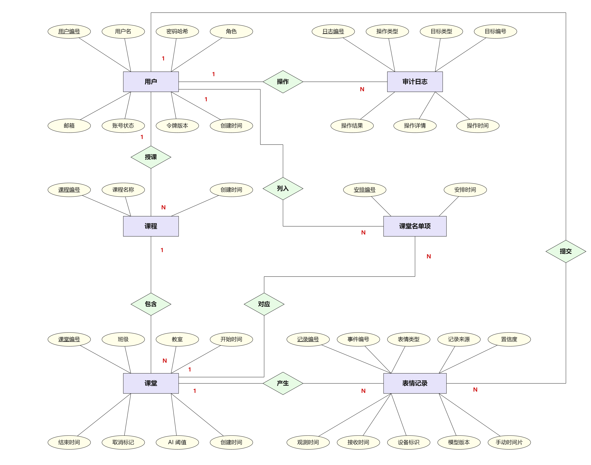

# 表情符号课堂情绪检查器系统数据库设计

## 1 设计概述

本设计依据[需求规格说明书](需求规格说明书.md)，使用 SQLite 存储用户、课程、课堂、名单、表情记录与审计日志。后端通过 SQLAlchemy 统一访问数据库，客户端和 AI 服务通过 API 读写业务数据。

## 2 实体关系

图中 PK 表示主键，FK 表示外键，UK 表示唯一键。关系说明如下：

| 关系 | 含义 |
| --- | --- |
| 用户 → 课程 | 一名教师可负责多门课程，每门课程必须对应一名教师 |
| 课程 → 课堂 | 一门课程可包含多节课堂，每节课堂必须属于一门课程 |
| 用户、课堂 → 名单 | 通过名单实现学生与课堂的多对多关系，同一课堂内学生不重复 |
| 课堂 → 表情记录 | 一节课堂可有多条记录，每条记录必须关联课堂 |
| 用户 → 表情记录 | 学生可有多条手动记录；AI 记录的用户为空 |
| 用户 → 审计日志 | 用户可产生多条日志；系统初始化等操作的操作者允许为空 |

## 3 表结构

以下类型为 SQLite 建表声明：整数主键、外键采用 `INTEGER`；字符串使用 `VARCHAR(n)` 或 `TEXT`，布尔值使用 `BOOLEAN`，浮点数使用 `FLOAT`，时间使用 `DATETIME`。SQLite 的字符串长度限制由请求校验保证。

### 3.1 用户表 users

| 字段 | 类型 | 可空 | 含义与默认值 |
| --- | --- | --- | --- |
| id | INTEGER | 否 | 主键，自动生成 |
| username | VARCHAR(32) | 否 | 唯一用户名 |
| password_hash | VARCHAR(255) | 否 | Argon2id 加盐密码哈希 |
| role | VARCHAR(32) | 否 | STUDENT、TEACHER、ADMIN |
| email | VARCHAR(120) | 是 | 邮箱 |
| status | VARCHAR(32) | 否 | ACTIVE、DISABLED；默认 ACTIVE |
| auth_version | INTEGER | 否 | 令牌版本，默认 1；修改密码或启停账号时递增 |
| created_at | DATETIME | 否 | 创建时间，默认当前 UTC 时间 |

### 3.2 课程表 courses

| 字段 | 类型 | 可空 | 含义与默认值 |
| --- | --- | --- | --- |
| id | INTEGER | 否 | 主键，自动生成 |
| name | VARCHAR(80) | 否 | 课程名称 |
| teacher_id | INTEGER | 否 | 外键，关联 users.id |
| created_at | DATETIME | 否 | 创建时间，默认当前 UTC 时间 |

### 3.3 课堂表 class_sessions

| 字段 | 类型 | 可空 | 含义与默认值 |
| --- | --- | --- | --- |
| id | INTEGER | 否 | 主键，自动生成 |
| course_id | INTEGER | 否 | 外键，关联 courses.id |
| class_name | VARCHAR(60) | 否 | 班级名称 |
| room | VARCHAR(60) | 是 | 教室 |
| start_at | DATETIME | 否 | 开始时间，UTC |
| end_at | DATETIME | 否 | 结束时间，UTC |
| cancelled | BOOLEAN | 否 | 是否取消，默认 false |
| ai_threshold | FLOAT | 否 | AI 置信度阈值，默认 0.6 |
| created_at | DATETIME | 否 | 创建时间，默认当前 UTC 时间 |

课堂状态不单独存储，由取消标记和服务器当前时间推导：取消优先，其余按 `[start_at, end_at)` 判断未开始、进行中、已结束。

### 3.4 课堂名单表 schedule_users

| 字段 | 类型 | 可空 | 含义与默认值 |
| --- | --- | --- | --- |
| id | INTEGER | 否 | 主键，自动生成 |
| session_id | INTEGER | 否 | 外键，关联 class_sessions.id |
| user_id | INTEGER | 否 | 外键，关联 users.id，业务限定为学生 |
| arranged_at | DATETIME | 否 | 安排时间，默认当前 UTC 时间 |

### 3.5 表情记录表 emoji_records

| 字段 | 类型 | 可空 | 含义与默认值 |
| --- | --- | --- | --- |
| id | INTEGER | 否 | 主键，自动生成 |
| event_id | VARCHAR(36) | 否 | 全局唯一事件编号，用于幂等确认 |
| session_id | INTEGER | 否 | 外键，关联 class_sessions.id |
| user_id | INTEGER | 是 | 外键，关联 users.id；手动为学生，AI 为空 |
| emotion | VARCHAR(32) | 否 | 七类表情枚举 |
| source | VARCHAR(32) | 否 | MANUAL 或 AI |
| confidence | FLOAT | 是 | AI 必填，取值 0—1；手动为空 |
| device_id | VARCHAR(60) | 是 | AI 必填的设备标识；手动为空 |
| model_version | VARCHAR(60) | 是 | AI 模型版本；手动为空 |
| observed_at | DATETIME | 否 | 观测时间，UTC；手动由服务端生成 |
| received_at | DATETIME | 否 | 接收时间，默认当前 UTC 时间 |
| manual_slot | INTEGER | 是 | 手动时间片序号；AI 或关闭时间片限制时为空 |

### 3.6 审计日志表 audit_logs

| 字段 | 类型 | 可空 | 含义与默认值 |
| --- | --- | --- | --- |
| id | INTEGER | 否 | 主键，自动生成 |
| actor_id | INTEGER | 是 | 外键，关联 users.id；系统操作可为空 |
| action | VARCHAR(60) | 否 | 操作代码，如 ADMIN_EXPORT_EMOJI |
| target_type | VARCHAR(40) | 是 | 目标类型 |
| target_id | VARCHAR(60) | 是 | 目标编号 |
| result | VARCHAR(20) | 否 | SUCCESS 或 FAILURE，默认 SUCCESS |
| detail | TEXT | 是 | 操作摘要，不含密码、密钥和原始人脸数据 |
| created_at | DATETIME | 否 | 操作时间，默认当前 UTC 时间 |

## 4 约束与索引

### 4.1 数据库约束

| 约束 | 保证的规则 |
| --- | --- |
| UNIQUE users.username | 用户名不重复 |
| UNIQUE courses(name, teacher_id) | 同一教师下课程名不重复 |
| UNIQUE schedule_users(session_id, user_id) | 同一课堂的名单成员不重复 |
| UNIQUE emoji_records.event_id | 同一事件不重复写入 |
| UNIQUE emoji_records(user_id, session_id, manual_slot) | 同一学生、课堂、时间片最多一条；空时间片不受此限制 |
| 枚举 CHECK | 用户角色、账号状态、记录来源及表情必须属于定义范围 |
| 置信度 CHECK | 非空置信度必须在 0—1 内 |
| MANUAL 结构 CHECK | 用户必须非空，置信度与设备必须为空 |
| AI 结构 CHECK | 用户和手动时间片必须为空，置信度与设备必须非空 |
| 审计结果 CHECK | result 只能为 SUCCESS 或 FAILURE |

表情枚举为 HAPPY、NEUTRAL、SAD、ANGRY、SURPRISED、FEARFUL、DISGUST；用户角色为 STUDENT、TEACHER、ADMIN；账号状态为 ACTIVE、DISABLED。

### 4.2 业务层校验

数据库保证字段与关联有效，后端进一步校验：课程教师须为启用教师，名单成员须为启用学生；课堂起止时间合法且阈值为 0—1；课堂开始后信息与名单冻结；手动提交须在名单内且课堂进行中；AI 事件须通过设备、课堂、时间窗口和阈值校验。

### 4.3 外键与历史保留

| 外键 | 数据库删除动作 |
| --- | --- |
| courses.teacher_id → users.id | RESTRICT |
| class_sessions.course_id → courses.id | CASCADE |
| schedule_users.session_id → class_sessions.id | CASCADE |
| schedule_users.user_id → users.id | CASCADE |
| emoji_records.session_id → class_sessions.id | CASCADE |
| emoji_records.user_id → users.id | SET NULL |
| audit_logs.actor_id → users.id | SET NULL |

上述动作定义引用完整性。业务接口使用账号停用，并保留课程、课堂与历史记录，不提供其物理删除操作。

### 4.4 查询索引

| 表 | 索引列 | 主要用途 |
| --- | --- | --- |
| users | role；status | 角色、状态筛选 |
| courses | teacher_id | 教师课程查询 |
| class_sessions | (course_id, start_at)；(start_at, end_at) | 课堂列表、时间及状态查询 |
| emoji_records | (session_id, observed_at) | 课堂历史、看板与趋势 |
| emoji_records | (user_id, observed_at) | 个人历史 |
| emoji_records | (source, observed_at) | 来源筛选与统计 |
| audit_logs | action；created_at | 审计操作与时间查询 |

唯一约束同时支持事件查重、名单校验和时间片冲突检测。

## 5 数据写入与一致性

- **名单替换**：在同一事务中删除旧名单、插入去重后的新名单并提交，避免出现部分保存。
- **手动提交**：按事件编号先查重，再验证课堂状态并写入；唯一约束冲突时回滚重查，同内容返回原记录，不同内容或时间片占用返回冲突。
- **AI 批量入库**：先做请求结构校验，再逐事件校验；每条插入使用保存点，单条冲突不影响其他合法事件，最后提交批次事务。
- **账号状态**：修改密码、启用或停用时递增 auth_version，使旧令牌失效；历史记录保持关联。
