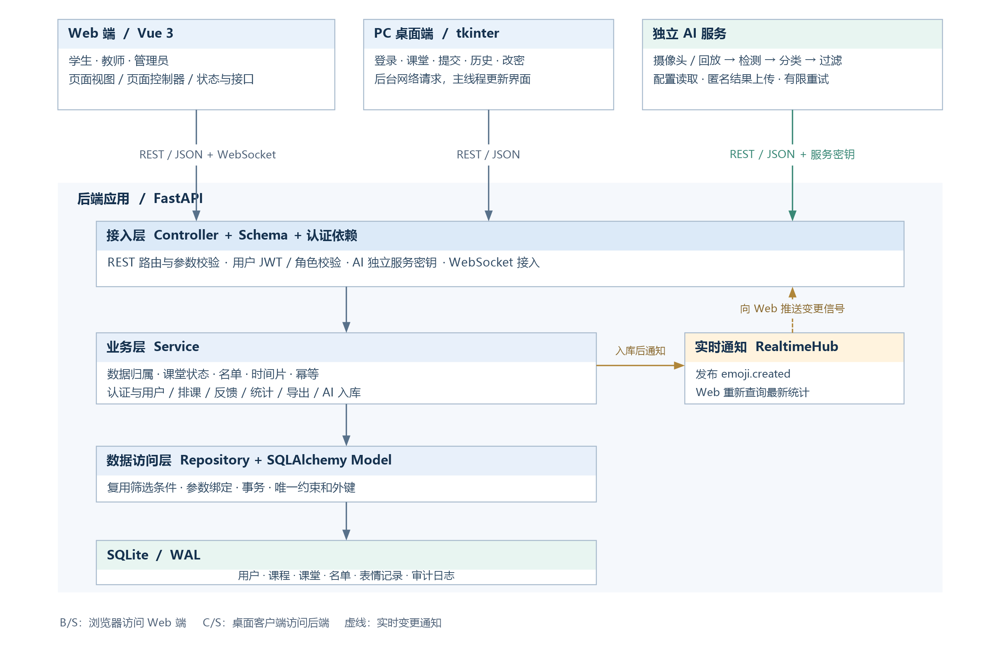
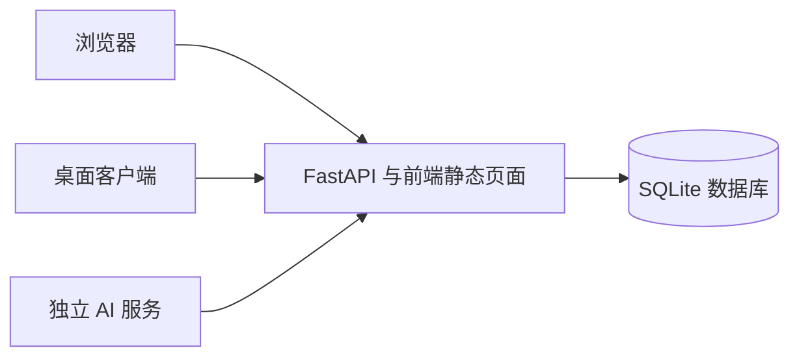
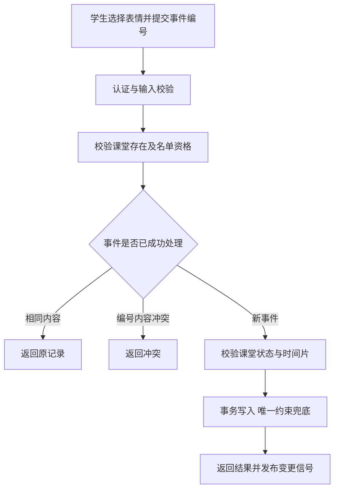
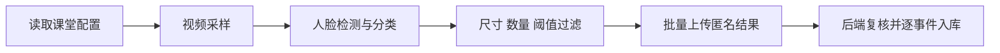

# 表情符号课堂情绪检查器系统概要设计

## 1 总体架构

### 1.1 系统结构
系统采用 C/S 与 B/S 混合架构，将 Web、桌面客户端、后端和 AI 服务分开组织，通过统一接口完成课堂反馈、查询、统计与导出。

Web 与桌面客户端共用业务接口，AI 通过独立服务认证上传结果，后端统一访问数据库。

| 组成 | 实现 | 职责 |
| --- | --- | --- |
| Web 端 | Vue 3、Element Plus、ECharts | 学生反馈、教师查询、管理员管理及统计图表 |
| 桌面客户端 | tkinter、urllib | 登录、选课堂、提交表情、个人历史、修改密码 |
| 接入层 | FastAPI Controller、Pydantic Schema、认证依赖 | 路由、输入校验、身份解析、角色授权和统一响应 |
| 业务层 | Service | 数据归属、课堂状态、名单、时间片、幂等、统计与审计 |
| 数据层 | Repository、SQLAlchemy Model、SQLite WAL | 查询、事务、表结构、唯一约束与外键 |
| AI 服务 | OpenCV、ONNX Runtime | 摄像头或回放采样、人脸检测、表情分类、过滤和上传 |
| 实时通知 | WebSocket、RealtimeHub | 发布记录变化信号，通知 Web 重新查询 |

各端只通过 API 访问业务数据。数据库由后端统一读写，AI 只上传匿名分类结果，原始人脸帧在内存中处理。

### 1.2 部署结构

后端通过 `127.0.0.1:8000` 提供 API，并托管前端构建产物；桌面端和 AI 服务按配置连接后端。局域网部署时，各端使用演示主机的访问地址。

## 2 修改版 MVC 与分层职责

### 2.1 Web 与桌面端

Web 页面在浏览器中渲染，页面控制器负责筛选、提交、查询和导出；状态与网络模块管理数据。学生和教师交互通过组合式函数组织，承担 ViewModel 职责。

| 职责 | 对应位置 | 说明 |
| --- | --- | --- |
| View 视图 | `frontend/src/views/`、`components/` | 页面、表格、表情选择器和图表 |
| Controller 控制器 | `frontend/src/controllers/` | 管理端筛选、课程课堂、名单与导出交互 |
| ViewModel | `frontend/src/composables/` | 学生反馈状态、教师看板刷新与学生明细 |
| Model 与接口访问 | `frontend/src/stores/`、`api/` | 登录状态、领域字典和后端调用 |
| 路由守卫 | `frontend/src/router/` | 按登录状态及角色显示和访问页面 |

桌面端中，`ApiClient` 封装接口，界面组件显示数据，`DesktopApp` 协调状态和后台请求。网络请求在后台执行，结果由主线程更新界面；令牌只存内存，退出即清除。业务校验由后端统一执行。

### 2.2 后端分层

| 层次 | 目录 | 职责 |
| --- | --- | --- |
| Controller | `backend/app/controllers/` | 接收请求、绑定参数、调用服务、返回响应 |
| Schema | `backend/app/schemas/` | 校验类型、必填字段、格式及范围 |
| 认证依赖 | `backend/app/core/deps.py` | 解析 JWT、核对账号与令牌版本、校验角色或 AI 密钥 |
| Service | `backend/app/services/` | 执行业务规则、数据归属校验和事务协调 |
| Repository | `backend/app/repositories/` | 封装查询并复用筛选条件 |
| Model | `backend/app/models/` | 定义实体、关系、索引和数据库约束 |

业务处理遵循 Controller → Service → Repository。查询、统计和导出共用 `EmojiFilters`，避免同一条件产生不同结果；前端菜单和路由守卫用于界面导航，后端执行最终授权。

## 3 模块设计

### 3.1 业务模块

| 模块 | 主要实现 | 核心职责 | 对应需求 |
| --- | --- | --- | --- |
| 认证与账号 | `AuthService` | 注册邀请码、登录、密码哈希、修改密码和令牌版本 | FR01 |
| 用户管理 | `UserAdminService` | 用户查询、创建师生、启停及受保护管理员校验 | FR02 |
| 课程课堂 | `CatalogService` | 教师关联、时间状态、取消、名单去重与开始后冻结 | FR03、FR04 |
| 表情记录 | `EmojiService` | 提交资格、时间片、事件幂等、个人历史及学生明细 | FR05—FR07 |
| 看板与统计 | `StatsService` | 手动与 AI 指标、覆盖率、类别分布和时间趋势 | FR08、FR09 |
| 记录明细与导出 | 历史查询、`ExportService` | 管理员分页查询、同条件 CSV、中文编码和公式防护 | FR10、FR11 |
| AI 入库 | `AiService` | 服务认证、设备、课堂、阈值、时效与逐事件结果 | FR12 |
| 桌面交互 | `desktop-client/client.py` | 五项学生操作及后台网络请求 | FR13 |
| 安全与审计 | 认证依赖、限流、审计记录 | 角色和归属、输入校验、关键操作日志 | FR14 |
| 初始化与运行 | 配置、`seed_demo.py`、应用入口 | 建表、演示数据、时间刷新与各端连接配置 | FR15 |

### 3.2 AI 服务模块

| 模块 | 职责 |
| --- | --- |
| 配置与入口 | 读取配置文件、环境变量和启动参数，获取课堂时间与阈值 |
| 采集 | 摄像头或本地回放采样，控制频率并释放资源 |
| 检测与分类 | YuNet 检测和人脸对齐，MobileFaceNet 分类，softmax 后选最高得分类别 |
| 过滤 | 按置信度、人脸尺寸和每帧数量过滤，生成事件编号和时间 |
| 上传 | 批量队列、退避重试、过期清理及接收或拒绝计数 |
| 主循环 | 协调采样、配置刷新和上传，按课堂状态等待或停止 |

## 4 关键业务流程

### 4.1 学生提交反馈

### 4.2 看板刷新与统计

Web 首次加载看板后建立 WebSocket 连接；收到 `emoji.created` 时重新查询看板和参与学生明细。页面可见时每 3 秒轮询，离开页面停止。

| 指标 | 计算口径 |
| --- | --- |
| 参与人数 | 手动记录中学生去重，AI 观察不计入 |
| 单课堂覆盖率 | 手动参与人数 ÷ 名单人数 |
| 看板类别占比 | 在 MANUAL 和 AI 各自分区内计算 |
| 多维统计占比 | 按当前筛选记录总数计算，可通过来源筛选分别查看 |
| 时间趋势 | 按观测时间和跨度选择 1、5、15、30、60 分钟粒度 |

### 4.3 AI 分析与上传

AI 服务使用独立密钥和设备标识；后端再次校验课堂状态、观测时间、阈值和事件唯一性，返回接收、重复或拒绝结果。整批字段非法时返回 422，不写入任何记录；单条拒绝不影响其他合法事件。

## 5 数据一致性与安全

### 5.1 数据与事务

- 六类核心实体为用户、课程、课堂、名单、表情记录和日志。手动记录关联学生，AI 用户为空；详细字段及关系见[数据库设计](04-数据库设计说明书-提交版.md)。
- 名单整体替换在单个事务中完成，课堂与学生组合唯一；手动与 AI 事件均由 `event_id` 唯一约束保证幂等。
- AI 入库逐事件使用保存点，单条冲突独立处理；手动时间片由组合唯一约束兜底。
### 5.2 权限与信息保护

| 控制项 | 设计 |
| --- | --- |
| 账号认证 | JWT 与账号状态、角色、令牌版本共同校验；修改密码或启停使旧令牌失效 |
| 角色与归属 | 学生仅本人记录，教师仅所授课程，管理员全局管理；CSV 仅管理员可导出 |
| 密码与注册 | Argon2id 加盐哈希；教师和管理员分别验证邀请码 |
| AI 认证 | 服务密钥与用户令牌分离，检查设备及课堂授权 |
| 输入与查询 | Schema 校验、SQLAlchemy 参数绑定、登录与提交限流 |
| CSV 安全 | UTF-8 BOM、标准转义、危险文本前置单引号 |
| 隐私与审计 | 原始人脸图像、视频及特征只在内存处理；关键操作记审计，不记录密码或密钥 |

## 6 接口与异常处理

业务 REST 接口统一使用 `/api/v1`，WebSocket 使用 `/ws/dashboard`；用户携带 Bearer JWT，AI 携带 `X-AI-Service-Key`。普通接口返回 `{code, message, data, request_id}`，CSV 使用文件流，`request_id` 用于关联响应与日志。

前端接口模块统一解析响应，后台统一处理业务异常、请求校验异常和服务异常。具体接口、字段及特殊返回规则见[接口文档](05-接口文档-提交版.md)。
